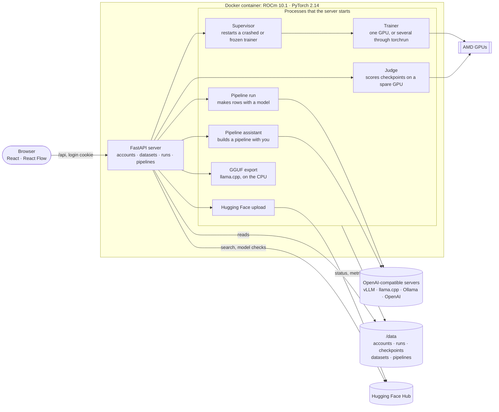

# Anvil

**A web app for generating synthetic training data, fine-tuning models on local AMD GPUs, and
exporting them to GGUF or Hugging Face.**


Anvil fine-tunes two kinds of model: language models, and decision models that answer typed
questions about an input (yes/no, a choice or a score) with probabilities. It runs in Docker on
ROCm.

<!-- SCREENSHOT: add a screenshot or GIF of Anvil here (a run's page with its charts, or the pipeline
     canvas). Save it as docs/images/anvil.png (or .gif) and uncomment the line below. -->
<!--  -->

## Why I built it

I would have used an existing tool such as Unsloth. When I started, it didn't support ROCm 10.1,
which my two Radeon AI PRO R9700 GPUs need for training, and it couldn't train across both GPUs, so
every run took twice as long. I built my own platform for fine-tuning and data generation instead.

I've used it to fine-tune Qwen3.5 models, including decision-0.8B, a safety classifier
([docs/DECISION-MODELS.md](docs/DECISION-MODELS.md)).

## Highlights

- **Training.** LoRA or full fine-tuning, data-parallel across GPUs with torchrun. Runs resume, on
  fewer GPUs if needed. Full fine-tuning in bf16 uses a custom AdamW with stochastic rounding.
- **Checkpoint selection.** A judge process scores each checkpoint on the validation set, on a spare
  GPU if there is one, with bootstrap standard errors and early stopping on a minimum gain. The test
  set is scored once, on the selected checkpoint.
- **Decision models.** Trained on the option letters' scores, or with Cloudflare's Clef joint
  schema head, which answers every question about an input in one forward pass. Metrics by question
  type: AUROC and recall at a fixed false-positive rate for yes/no, macro-F1 for choices, MAE for
  scores.
- **Synthetic data pipelines.** A node editor (React Flow) for generation pipelines against any
  OpenAI-compatible endpoint, with row-level previews, resumable runs and six templates. A
  tool-calling assistant builds a pipeline from a description; only you start a full run.
- **Data checks.** Row validation, exact and MinHash near-duplicate removal, and removal of
  validation and test rows whose input also appears in training.
- **Fault tolerance.** Atomic checkpoints with optimizer state, a supervisor that restarts crashed
  or stalled trainers, and NaN/inf batch skipping.
- **Export.** GGUF (BF16 to Q4_K_M) through llama.cpp, with Clef heads kept for llama-server, and
  upload to Hugging Face with a generated model card.

Also: a check on training rows that flags memorised questions, password login, and freeing GPUs
from a model server on the same machine before a run.

## Architecture



The API server never trains. Each long job (trainer, judge, pipeline run, assistant turn, export,
upload) runs as its own process and reports through files in its run or pipeline folder, so a
server restart doesn't stop a run.

| Path | What it holds |
|---|---|
| `server/anvil/main.py` | The API, and the built frontend at every other path |
| `server/anvil/train.py`, `tasks.py` | The trainer process, and what each kind of model learns and how it's scored |
| `server/anvil/judge.py`, `picking.py` | Checkpoint scoring on a spare GPU, ranking and early stopping |
| `server/anvil/supervisor.py`, `parallel.py` | Restarts after crashes and freezes, and multi-GPU training |
| `server/anvil/datasets.py` | Dataset loading, row checks, deduplication and splits |
| `server/anvil/pipelines.py`, `generate.py`, `assistant.py` | Pipelines, their runs and the assistant |
| `server/anvil/export.py`, `upload.py` | GGUF export with llama.cpp, and Hugging Face uploads |
| `server/anvil/optim.py` | AdamW for bf16 weights, with stochastic rounding |
| `server/anvil/vendor/clef/` | Cloudflare's Clef reference code, unmodified (Apache-2.0) |
| `web/src/` | The React app; the pipeline editor is in `web/src/pipeline/` |
| `docker/` | The image, and the scripts the containers run |

## Tech stack

| Area | Tools |
|---|---|
| Backend | Python 3.12, FastAPI, Uvicorn, SQLite (accounts) |
| Training | PyTorch 2.14 on ROCm 10.1, Hugging Face Transformers, PEFT (LoRA), torchrun, flash-linear-attention and causal-conv1d kernels |
| Data | Hugging Face Datasets, pandas, PyArrow, datasketch (MinHash) |
| Decision models | Cloudflare's Clef joint schema head |
| Export and sharing | llama.cpp v0.7.0 (GGUF conversion and quantisation), huggingface_hub |
| Frontend | React 19, TypeScript, Vite, React Flow, Tabler icons |
| Infrastructure | Docker Compose, a dev container |
| Tests | pytest, with the trainer tests on the CPU |

## Quick start

You need Linux with Docker Compose, an AMD GPU that ROCm 10.1 supports (NVIDIA isn't supported) and
about 40 GB of disk for the image.

```bash
git clone https://github.com/TariqKirsten/anvil.git && cd anvil
cp .env.example .env     # set ANVIL_PASSWORD, ANVIL_GPU_ARCH, the four folders and your UID/GID
sudo mkdir -p /srv/anvil/{data,hf-cache,models,datasets}
sudo chown -R "$(id -u):$(id -g)" /srv/anvil
docker compose build     # slow the first time: a large ROCm image, and kernels built for your GPU
docker compose up -d app
```

Then open `http://localhost:8420` and log in as `admin` with the password from `ANVIL_PASSWORD`.
[docs/GUIDE.md](docs/GUIDE.md) covers configuration, development and each part of the app.

## Status

A personal project, built for my own machine. There are no releases, so build from source. The
pipeline templates' Model steps point at a model server on my machine; change them to your
endpoint.

Next:
- QLoRA (4-bit).
- Run each pipeline template end to end.
- Test the Hugging Face upload against a real account. So far, tests use a fake Hub.
- Document the assistant on the app's Docs page.

## License

[MIT](LICENSE), except `server/anvil/vendor/clef/`, which is Cloudflare's code under the
Apache-2.0 licence ([its LICENSE](server/anvil/vendor/clef/LICENSE) and
[NOTICE.md](server/anvil/vendor/clef/NOTICE.md)).
